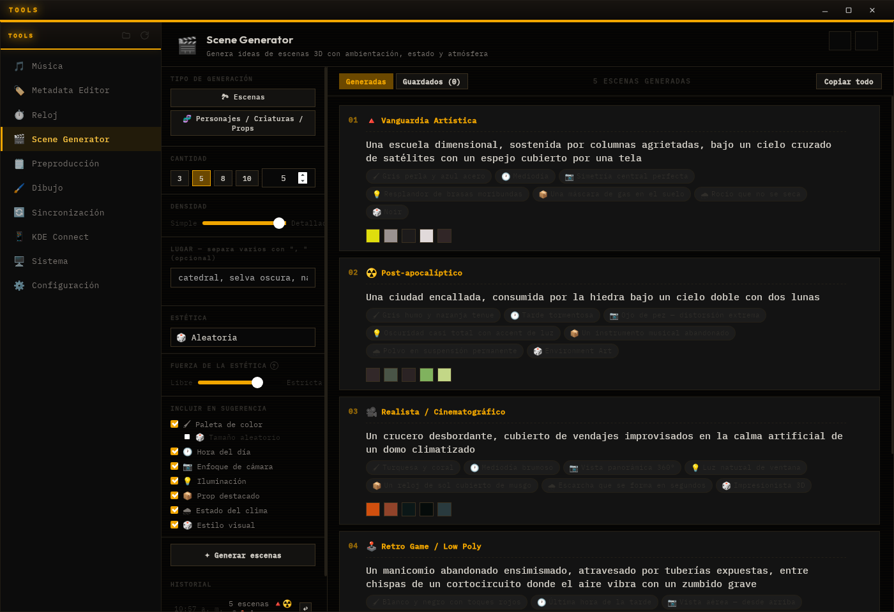

  

<h1 align="center">Atelier</h1>

  Un taller de herramientas creativas y de uso diario, en una sola app de escritorio.

  <a href="../../releases/latest"><b>Descargar la última versión</b></a>
  &nbsp;·&nbsp; Windows &nbsp;·&nbsp; Linux

  

## Qué es

Atelier reúne en una ventana las herramientas que uso a diario para proyectos audiovisuales y para el equipo: escribir un guion, armar un storyboard, buscar ideas, ordenar música, sincronizar carpetas. Cada herramienta tiene su pestaña en la barra lateral.

## Herramientas

| Herramienta | Para qué sirve |
|---|---|
| **Preproducción** | Documento de diseño, guion, guion literario, diseño sonoro y storyboard para un juego, un corto o cualquier proyecto. |
| **Scene Generator** | Ideas de escenas 3D, personajes y props, con estética, hora del día, encuadre, iluminación y paleta de color. |
| **Dibujo** | Lienzo con capas, pinceles con presión, selección y filtros. |
| **Música** | Descarga audio y te recomienda música a partir de tu biblioteca. |
| **Metadata Editor** | Corrige etiquetas, portadas y letras de carpetas enteras de música. |
| **Reloj** | Pomodoro, cronómetro, temporizador, alarmas, reloj mundial y clima. |
| **Sincronización** | Mantiene carpetas al día entre tus dispositivos con Syncthing. |
| **KDE Connect** | Conecta tu celular con el computador. |
| **Sistema** | Uso de recursos, procesos, pantallas, limpieza y chequeos del equipo. |

## Instalación

Descarga el archivo de tu sistema desde [Releases](../../releases/latest). Los enlaces "Source code" que GitHub añade a cada versión no son el programa, no los necesitas.

| Sistema | Archivo |
|---|---|
| Windows 10 u 11 | El instalador `…_x64-setup.exe` |
| Linux (x86-64) | El `…_amd64.AppImage`: dale permiso de ejecución (`chmod +x`) y ábrelo |

En Windows puede aparecer un aviso de SmartScreen porque el instalador no está firmado con un certificado de pago. Elige *Más información → Ejecutar de todas formas*.

macOS no tiene versión por ahora.

## Actualizaciones

La app busca versiones nuevas al abrirse y desde el botón de actualizar de la barra lateral. Las actualizaciones van firmadas. En Linux se actualiza sola la versión AppImage.

---

Este repositorio solo publica los instaladores; el código fuente es privado. Si algo falla o tienes una idea, abre un [issue](../../issues).
